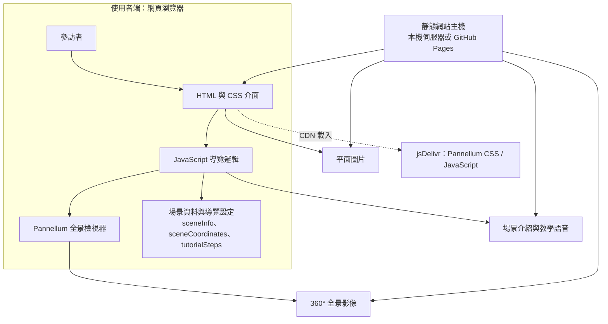

# 智慧場域實境模擬參訪系統

利用 360 度環景拍攝或數位標註工具，設計一套不需同仁全程帶看的網頁版導覽介面。

## 目錄

- [專案簡介與核心定位](#專案簡介與核心定位)
- [功能特色](#功能特色)
- [核心功能模組詳解](#核心功能模組詳解)
- [使用技術](#使用技術)
- [系統架構](#系統架構)
- [專案檔案](#專案檔案)
- [開始使用](#開始使用)
- [部署至 GitHub Pages](#部署至-github-pages)
- [調整場域內容](#調整場域內容)
- [安全規則](#安全規則)

## 專案簡介與核心定位

本專案以蘆洲集賢社區長照機構為場域，將櫃檯、日照生活室、教室、活動區及友善設施等空間，串接成可自行探索的線上參訪體驗。使用者透過瀏覽器即可環視場域、閱讀空間介紹並依需求切換場景。

**核心定位**：以 360° 環景與數位導覽介面，提供可重複使用、自主操作的場域參訪方式，讓訪客先在線上認識空間與服務資訊，減少同仁全程陪同導覽的需求。此系統作為資訊展示與參訪輔助工具，不取代現場人員提供的即時協助或正式服務說明。

## 功能特色

- **360° 全景參訪**：以拖曳或觸控方式環視各空間。
- **場景熱點導覽**：點選影像中的導覽熱點，在櫃檯、鞋櫃、走廊、日照生活室、教室、活動區及廁所等場景間移動。
- **空間文字與語音介紹**：查看場景說明，並播放對應語音。
- **平面圖檢視**：從教室區開啟廚房及逃生區、洗手台的平面圖片與說明。
- **地圖與快速選單**：透過迷你地圖、放大地圖或場景選單查看位置及快速前往空間。
- **操作教學**：提供逐步教學，可重新開始或略過。
- **返回與操作提示**：支援返回上一個場景，並提供初次環視提示。

## 核心功能模組詳解

### 1. 360° 全景場景檢視

以 Pannellum 呈現各空間的全景照片。使用者可用滑鼠拖曳或觸控環視畫面，從不同方向觀察場域。

### 2. 場景熱點與空間漫遊

在全景場景中放置互動熱點，連結相鄰空間；點選熱點即可切換場景。導覽路徑涵蓋櫃檯、鞋櫃、走道與走廊、日照生活室、教室、活動區及廁所等空間。

### 3. 空間介紹與語音播放

依目前場景顯示空間名稱和文字介紹，並可播放相對應的場景語音。播放新語音時會停止前一段播放；瀏覽器可能要求使用者先點擊畫面，才能啟用音訊。

### 4. 地圖定位與快速導覽

迷你地圖及放大地圖顯示目前所在位置；快速選單可直接跳至指定場景，返回按鈕則依瀏覽歷程回到上一個場景。

### 5. 平面圖與補充資訊

從教室場景可開啟廚房、逃生區及洗手台的平面圖片與說明，補充全景影像不易表達的配置細節。

### 6. 操作教學與操作提示

逐步教學介紹環視、場景切換、地圖及快速導覽等操作。使用者可略過教學，之後也能重新開啟；初次參訪時另提供環視操作提示。
## 使用技術

- HTML、CSS、JavaScript
- [Pannellum 2.5.6](https://pannellum.org/) 全景檢視器，透過 jsDelivr CDN 載入

## 系統架構

本系統採用靜態網頁架構，由瀏覽器直接載入 HTML、場域影像與音訊資源；目前版本未設定後端 API 或資料庫。Pannellum 負責呈現 360° 全景，JavaScript 管理場景切換、互動熱點、地圖標記、空間介紹、語音播放及操作教學。

**資料流程**：瀏覽器從靜態網站主機取得網頁與媒體檔；參訪者操作介面後，JavaScript 依場景設定呼叫 Pannellum 切換全景，並更新地圖位置及空間介紹。需要語音時，瀏覽器播放對應的音檔。Pannellum 程式庫則由 jsDelivr CDN 提供。
## 專案檔案

目前版本為單一 HTML 頁面，並以相對路徑載入場景影像、平面圖及語音檔。請將下列資源放在 HTML 檔同一層（或同步修改程式中的路徑）：

- **全景影像**：場景設定中 `panorama` 指定的 `.jpg` 檔，例如 `櫃台.jpg`、`上課區.jpg`、`走廊.jpg`、`平安家.jpg`。
- **平面圖片**：`廚房.jpg`、`逃生.jpg`。
- **場景語音**：`sceneAudioFiles` 中指定的 `.mp3` 檔，例如 `櫃台.mp3`、`教室.mp3`。
- **教學語音**：`tutorialAudioFiles` 中指定的 `.mp3` 檔，包括 `1.mp3` 至 `9.mp3`、`tutorial_step10.mp3`、`tutorial_step11.mp3`。

請依 HTML 中的場景與音檔設定備齊對應檔案；檔名需與設定完全一致。若未提供音檔，相關語音播放功能將無法播放；缺少全景影像時，對應場景也無法正常顯示。

## 開始使用

1. 將 HTML 檔及所需影像、音訊檔放在同一個資料夾。
2. 使用瀏覽器開啟 HTML 檔即可參訪。若瀏覽器限制本機檔案載入，請改用本機 HTTP 靜態伺服器，例如 VS Code 的 Live Server。
3. 首次進入時點擊畫面提示以啟用音訊；可跟隨教學操作，或關閉教學後自行探索。

> Pannellum 由 CDN 載入，因此首次載入頁面需要網路連線。

## 部署至 GitHub Pages

1. 將 HTML 檔、場景全景圖、平面圖片與音檔一併提交至 GitHub 儲存庫。
2. 若入口檔名稱不是 `index.html`，建議將其改名為 `index.html`，方便以專案網址直接開啟。
3. 在儲存庫的 **Settings → Pages**，選擇部署來源分支及目錄（例如 `main` 與 `/ (root)`），並儲存設定。
4. 等待 GitHub Pages 完成部署後，使用 Pages 提供的網址開啟導覽頁。

請確認場景資產已納入儲存庫，且檔名大小寫、中文字及相對路徑完全相符。GitHub Pages 網址大小寫有別於本機 Windows 檔案系統。

## 調整場域內容

- **新增或修改場景**：編輯 `viewer` 設定中的 `scenes`，設定場景標題、全景圖檔及 `hotSpots` 導覽位置。
- **修改介紹文字**：編輯 `sceneInfo` 中的標題、描述及 `sceneAudioFiles` 對應音檔。
- **調整地圖位置**：修改 `sceneCoordinates` 中各場景的地圖座標百分比。
- **更新場域地圖及平面圖**：更換對應圖片並確認程式中的檔名和路徑。
- **編輯操作教學**：修改 `tutorialSteps` 及 `tutorialAudioFiles`。

新增場景時，請一併確認其介紹資料、地圖座標、音檔（如有）及相鄰場景的導覽熱點設定。

## 安全規則

目前系統以瀏覽器端靜態網頁運作，未設定帳號登入、後端 API、資料庫或權限管理。以下為內容維護及部署時應遵守的安全規則；這些規則不代表系統已具備伺服器端驗證或存取控制。

- **不放入機密資料**：不得將密碼、API 金鑰、存取權杖、內部連線資訊或其他憑證寫入 HTML、JavaScript、README 或公開儲存庫。
- **保護個人隱私**：上傳照片或語音前，確認取得必要授權；避免呈現可識別服務對象、家屬或工作人員的個人資料、名牌、病歷、聯絡資訊及其他敏感資訊。
- **只使用可信任的內容**：場景文字、熱點標籤與媒體檔應由可信任的維護者提供。若未來允許外部使用者提交內容，應先進行驗證與安全處理，避免將未檢查的內容直接當作 HTML 插入頁面。
- **維持資源來源安全**：使用 HTTPS 網站部署，確認全景圖、平面圖及音訊使用正確路徑，並僅載入可信任的外部程式庫來源。
- **限制公開資產**：GitHub Pages 是公開網站；提交到公開儲存庫的 HTML、影像及音訊可被他人瀏覽或下載，不應放置僅供內部使用的檔案。
- **定期檢視依賴與內容**：更新外部程式庫版本前確認來源；場域照片、介紹文字及導覽連結變更後，檢查是否仍正確且沒有不必要的資訊揭露。

